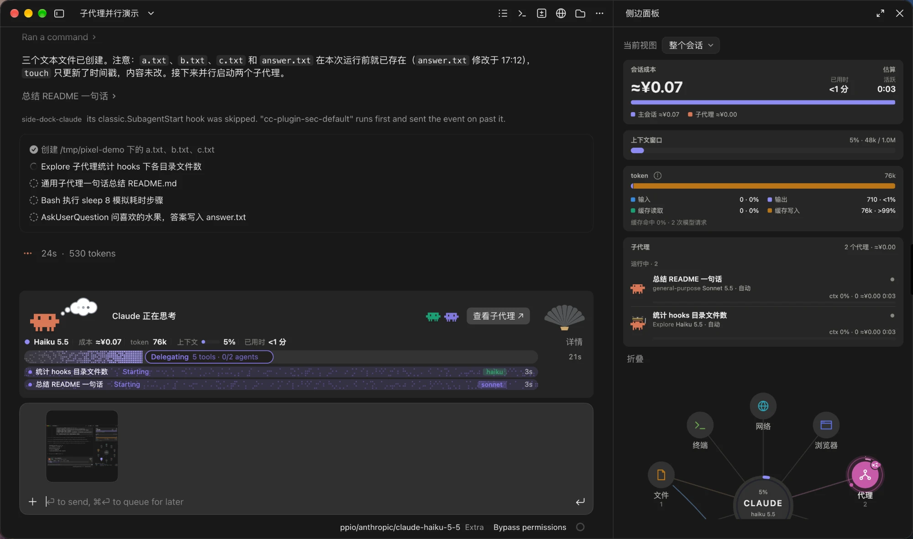
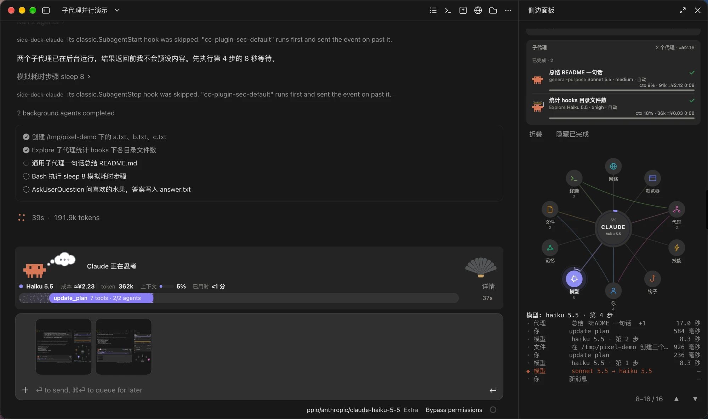
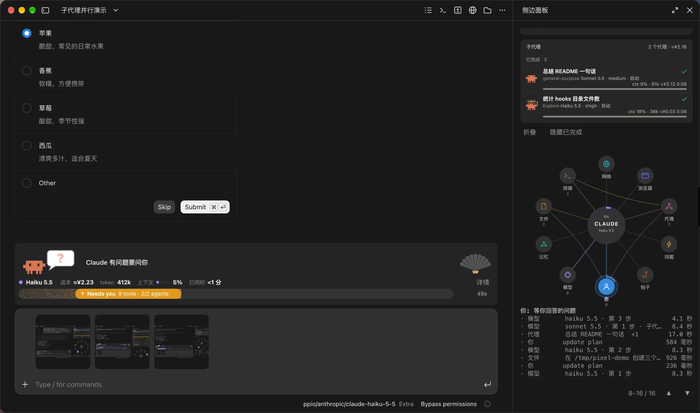
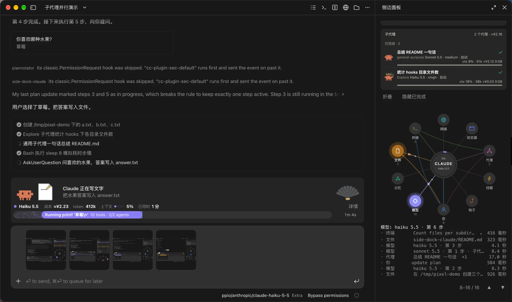
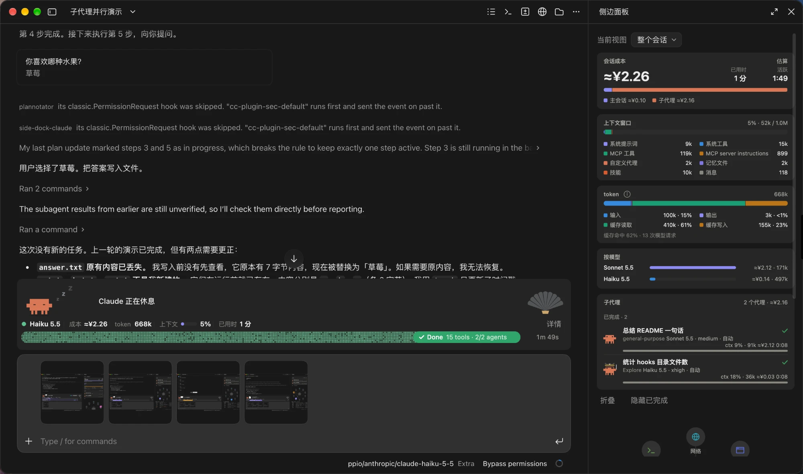
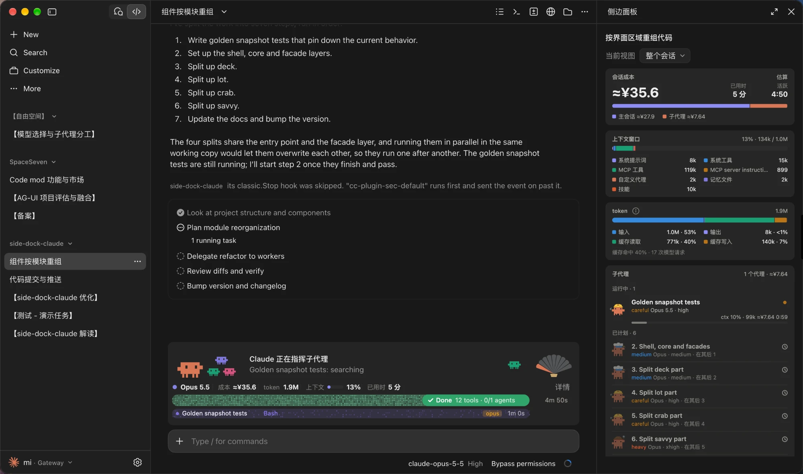

# side-dock-claude

> 把 **crab-cam**、**lot-map**、**savvy-progress** 三个公开 mod 合并重制，并移植 **claude-deck** 的 Pixel 计划条的 Claude Code 桌面版侧边面板。
> A Claude Code (desktop app) mod that merges three public mods, plus claude-deck's Pixel plan bar, into one right-side **Dock** pane and one band above the prompt.

三个原版 mod 各占一个面板、各自注册命令，同时装会挤占界面、互相重复。这个 mod 把它们收进**同一个右侧 Dock**，并补上原版没有的能力：费用持久化、人民币估价、子代理模型路由、中文界面等。

- 插件 id、marketplace 名与仓库名都是 `side-dock-claude`；当前版本见 [plugin.json](.claude-plugin/plugin.json)，改动历史见 [CHANGELOG.md](CHANGELOG.md)
- 技术栈：TypeScript / TSX，通过 Claude Code mod 的 `hooks` 机制运行，无构建步骤、无外部运行时依赖
- 许可：MIT（上游项目同为 MIT，版权声明原样保留，见文末）

---

## 它长什么样

### 右侧 Dock 面板（自上而下）

| 区块 | 内容 | 来源 |
| --- | --- | --- |
| **会话面板 Session** | 会话成本、上下文窗口占用、token 拆分（输入 / 输出 / 缓存读 / 缓存写 / 缓存命中率）、5 小时与 7 天用量限额；有子代理时多一张 Subagents 卡片，列出主会话与各子代理的模型、上下文和花费（没有子代理时隐藏） | savvy-progress |
| **工作地图 Work map** | 雷达式地图：中心是 Claude，周围 10 个站点（你、模型、记忆、文件、Shell、网络、浏览器、子代理、技能、钩子），每次工具调用点亮对应站点和连线。地图下方是调用记录，一次显示 8 行，用 ▲ / ▼ 翻看更早或更新的记录 | lot-map |
| **螃蟹小组 Crab crew** | 每个子代理一张卡片，显示状态和已用时间；默认关闭，`/crab-cam crew` 打开 | crab-cam |

### 输入框上方

- **螃蟹**：随 Claude 的状态切换场景（思考、读文件、写代码、跑测试、git、装依赖、搜索、联网、等待权限、出错、压缩上下文、完成等共 25 种）。
- **统计行**：费用 / token / 上下文 / 已用时间 / **Details** 按钮（点击或输入 `/agents-info` 折叠、展开会话面板）。
- **Pixel 计划条**（桌面版专有，移植自 claude-deck）：任何会话都会显示，内容是 Claude 的 todo 列表、任务工具、批准的计划，或没有计划时的「正在做什么」；子代理以细条显示在下方，附模型、当前工具和耗时。已完成的行会保留到你发下一条消息。它取代了 savvy flow 自带的进度条，会话面板和统计行不受影响。

### 实际运行示例

以下截图来自一次子代理并行演示：两个子代理同时运行，随后依次完成一个 AskUserQuestion 选择题，并写入一个文件。













---

## 安装

```
/plugin marketplace add LeonardoRain/side-dock-claude
/plugin install side-dock-claude --marketplace side-dock-claude
```

> **请先停用原来的 crab-cam、lot-map、savvy-progress 三个 mod**，否则命令和画面会重复出现。

安装后提供两个 MCP 工具，供 `savvy-flow` 技能上报进度：`mcp__side-dock-claude__progress`（整体计划）与 `mcp__side-dock-claude__step`（单个子代理的步骤）。技能文本里原有的 `mcp__savvy-progress__*` 会被自动改写为 `mcp__side-dock-claude__*`，无需手改技能。

---

## 命令

| 命令 | 作用 |
| --- | --- |
| `/crab-cam` | 隐藏 / 显示螃蟹 |
| `/crab-cam demo` | 依次播放全部 25 个场景（每个 3 秒），结尾附带一组示例子代理 |
| `/crab-cam meter` | 显示 / 隐藏螃蟹壳上的用量仪表（肋骨 = 上下文，珍珠 = 5 小时 / 一周限额） |
| `/crab-cam details` | 在仪表旁用数字写出具体读数 |
| `/crab-cam commands` | 命令按原文显示，而非按"它做什么"的描述显示（切换） |
| `/crab-cam crew` | 打开 / 关闭螃蟹小组区块 |
| `/lot-map` | 打开 Dock 面板 |
| `/agents-info` | 折叠 / 展开会话面板 |
| `/agent-routing` | 查看或设置子代理模型路由（见下） |

---

## 在原版之上做的改动

1. **合并为一个面板**：四个来源统一画进同一个 Dock，状态（atom）都归在 `side-dock-claude` 名下。同名事件钩子串成一条链（crab-cam 在最外层），某一部分绘制失败只会让自己那块留空，不拖垮其他部分。
2. **会话成本跨重启保留**：成本按会话 id 存入 `$.store`（键 `cost:<session id>`），重启后恢复；下次启动时清理对话记录已不存在的条目。mod 无法感知"归档"，被归档的会话会保留其成本记录。
3. **费用估价（$ 或 ¥）**：引擎只上报 token 数，不报金额，所以面板里的费用都是按 token 数乘价目表**估算**的，**不是账单**（面板里 token 总数旁的信息图标有同样的提示）。
   - 币种由 `currency` 决定（`USD` 显示 `$`，`CNY` 显示 `¥`），价格一律按"该币种每百万 token"计。默认价目表是 Anthropic 官方标价（USD，2026-11-18 核对）；选 `CNY` 且不填自己的价格时，按固定汇率 1 美元 = 7 元折算。Haiku 5.5 按单次请求的提示长度（输入 + 缓存读 + 缓存写）分两档。
   - Fable / Opus / Sonnet / Haiku 各有一个价格框（`priceFable` 等），写成 `输入/输出/缓存读/缓存写`，如 `28/140/1.4/35`。长提示分档在逗号后追加 `提示token数>价格`，如 `0.7/3.5/0.07/0.875, 100000>3.5/17.5/0.35/4.375`。填了就替换该系列的全部默认价。
   - 按精确模型名定价（例如走网关、价格与官方不同）用 `modelPrices`，每条写成 `模型=输入/输出` 或 `模型=输入/输出/缓存读/缓存写`，如 `opus-5-5=28/140/1.4/35`。模型名按片段匹配、取最长的；只写两个数时，缓存读按输入价的 0.1 倍、缓存写按 1.25 倍；分档写 `模型>提示token数=...`，如 `haiku-5-5>100000=0.5/2.5`。写错的条目会被忽略。
   - 未识别的模型按表里最贵的计价，宁可高估也不低估。
   - 切换币种后，已保存的旧会话成本按上述固定汇率换算，小数位只是近似。
4. **子代理模型路由**：当 `Agent` 调用没有指定模型时，可为 `Explore` 与 `general-purpose` 两类内置子代理分别指定默认模型。
   - `/agent-routing on`：Explore → haiku，general-purpose → sonnet
   - `/agent-routing off`：都恢复为继承主会话模型
   - `/agent-routing explore <模型>` / `/agent-routing general <模型>`：单独设置，模型可选 `inherit | haiku | sonnet | opus | fable`
   - 调用里显式写了模型、fork、workflow 子代理、teammate 以及自定义类型的子代理不受路由影响。被路由的子代理会在面板里标 "auto"。
5. **Pixel 计划条**：见上文，改自 claude-deck，只保留 Pixel 样式。
6. **界面语言只保留英文和简体中文**：工作地图、Dock 标题和会话面板只支持 `en` 与 `zh`，上游的其他语言文案已删除。

---

## 配置项

在插件设置里调整（定义见 [plugin.json](.claude-plugin/plugin.json) 的 `userConfig`），常用的有：

| 配置 | 说明 | 默认 |
| --- | --- | --- |
| `language` | 工作地图与 Dock 标题的语言（`en` / `zh`） | `en` |
| `agentsLanguage` | 会话面板语言：`auto`（跟随 Claude Code 语言设置，再跟随系统）/ `en` / `zh`；螃蟹上方的状态行和 "Watch crew" 按钮也跟随它 | `en` |
| `coreName` | 地图中心圆圈的文字，最多 10 个字符 | `CLAUDE` |
| `theme` / `background` | 地图配色（`auto` / `dark` / `light`）与背景（`solid` / `transparent`）；`colors` 可按 `name=#rrggbb` 覆盖单个颜色 | `auto` / `transparent` |
| `layout` / `motion` / `textSize` | 你在地图上或下；`reduced` 关闭飞行与旋转；地图下方文字行字号 | `you-bottom` / `full` / `footnote` |
| `terminalView` / `cellShape` | 终端显示方式：`text` / `picture`（kitty、Ghostty 等）/ `braille`（盲文点阵），以及图片模式的字符格高宽比 | `picture` / `2.4` |
| `memoryServers` / `memoryCommands` / `memorySubcommands` / `memoryPaths` / `memoryLabels` | 哪些 MCP 服务器、命令、路径算作"记忆"，用来点亮记忆站点 | `memory` |
| `hookRecords` / `hookReasons` | 是否显示钩子添加的 `[#123]` 编号记录；是否显示钩子拒绝的原因（默认只显示哪个工具被拦，避免泄露钩子读到的内容） | 关 |
| `subagentNames` / `contextCost` | 行内显示子代理名称；显示每次调用让上下文增长的估算 token 数 | 关 |
| `autoOpen` | `savvy`：savvy-flow 启动时自动打开面板；`any`：任意子代理启动都打开 | `any` |
| `exploreModel` / `generalModel` | 子代理模型路由的持久化选项，与 `/agent-routing` 等效 | `haiku` / `sonnet` |
| `currency` / `priceFable` / `priceOpus` / `priceSonnet` / `priceHaiku` / `modelPrices` | 费用币种与各模型每百万 token 的价格，见上文「费用估价」 | `USD` / 官方标价 |

---

## 项目结构

```
.claude-plugin/
  plugin.json          插件清单与全部配置项
  marketplace.json     单插件 marketplace
hooks/
  hooks.json           模块清单，入口是 register.tsx
  register.tsx         入口：把四部分的钩子串成链，绘制 Dock 面板与输入框上方一行
  dock.ts              Dock 面板的开合与区块状态（crew / agents）
  lang.ts              界面语言解析
  crab/                crab-cam：螃蟹场景、活动识别、子代理小组、用量仪表
  lot/                 lot-map：站点分类、地图绘制、盲文 / 图片终端渲染、调用记录
  savvy/               savvy-progress：会话面板、费用估算（pricing.ts）、子代理路由
  deck/                claude-deck：Pixel 计划条
  *.test.ts(x)         测试
types/index.d.ts       共享类型
```

`crab/`、`lot/`、`savvy/`、`deck/` 各自保持上游的结构，方便以后对照上游更新合并。

---

## 开发

```
claude plugin validate .
claude plugin test .
claude --plugin-dir .          # 编辑时热加载
```

已安装的副本按版本号缓存：改动 `hooks/`、`types/` 或 `.claude-plugin/` 后，要把 `plugin.json` 的 `version` 加一并在 `CHANGELOG.md` 顶部补一条，再运行 `claude plugin update side-dock-claude@side-dock-claude` 并重启 Claude，改动才会生效。只改 README 等文档不需要升版本。

---

## 来源与许可 / Credits and licence

本 mod 改编自四个 MIT 许可的开源项目，感谢原作者：

| 部分 | 上游 | 作者 |
| --- | --- | --- |
| crab-cam 0.4.0 → `hooks/crab` | [sTomerG/agent-kit](https://github.com/sTomerG/agent-kit) | Tomer Gabay |
| lot-map → `hooks/lot` | [alexeyw/lot-map](https://github.com/alexeyw/lot-map) | Aleksei Volodin |
| savvy-progress 1.2.0-sgs → `hooks/savvy` | [Phalegethon/sgs-kit](https://github.com/Phalegethon/sgs-kit)（fork 自 [johnnyvizz/claude-kit](https://github.com/johnnyvizz/claude-kit)） | Gürkan Süerdem、johnnyvizz |
| claude-deck 0.5.1（仅 Pixel 计划条）→ `hooks/deck` | [nvr0x5/claude-deck](https://github.com/nvr0x5/claude-deck) | nvr0x5 |

各上游的许可全文保留为 `LICENSE.crab-cam`、`LICENSE.lot-map`、`LICENSE.savvy-progress`、`LICENSE.claude-deck`，核对详情见 [THIRD_PARTY.md](THIRD_PARTY.md)。合并后的整体及上述改动同样以 MIT 发布（[LICENSE](LICENSE)）。原作者不为本项目背书。
